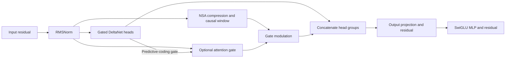

# Architecture and module map

HSPMN compares hybrid recurrent-attention language models with dense
Transformers. The manuscript's v5 configuration combines a Gated DeltaNet
recurrent stream and an NSA attention stream within each block.

The implementation is a research reference, not a drop-in implementation of
either the original Hymba model or the full NSA architecture. Recorded training
settings are in the [experiment tables](results/phase2_combined_140m_2026-05-12.md).
Current correctness limits are in [TROUBLESHOOTING.md](TROUBLESHOOTING.md).

## Head-fusion path

The recurrent and attention head groups receive projections of the same
normalized input. Their outputs are concatenated. The default
`hymba-with-nsa` variant does not use the NSA selection branch and has no
extra attention gate. NSA's internal branch-mixing gates remain present.

The learned gate uses the current token's hidden state. The random-gate control
freezes its projection weights. The predictive-coding gate uses recurrent-output
magnitudes normalized with prefix statistics. Automatic block selection now
selects only completed compression blocks for each query. Earlier releases used
whole-sequence statistics and pooled future queries; those paths were not causal.

## Code entry points

| Module | Role |
|---|---|
| [train_v4.py](train_v4.py) | Shared model factory, token batches, validation and trainer |
| [train_p4_350m.py](train_p4_350m.py) | Larger-scale trainer with resume checkpoints |
| [hymba_with_nsa_lm.py](hymba_with_nsa_lm.py) | Embeddings, hybrid blocks and language-model loss |
| [hymba_with_nsa_block.py](hymba_with_nsa_block.py) | Head fusion, optional gate and decorrelation loss |
| [gated_deltanet.py](gated_deltanet.py) | Recurrent stream, optional FLA kernel and PyTorch reference |
| [nsa_attention.py](nsa_attention.py) | Compression, selection and sliding-window attention |
| [hspmn_v3_0.py](hspmn_v3_0.py) | Shared rotary embeddings and earlier model components |
| [utils_v3_0.py](utils_v3_0.py) | Configuration, device selection, seeding and logging |
| [hspmn_v4_0.py](hspmn_v4_0.py), [router_v4_0.py](router_v4_0.py) | Earlier block-fusion comparison |
| [hymba_block.py](hymba_block.py) | Dense-attention hybrid comparison |
| [rwkv7_block.py](rwkv7_block.py), [mamba3_block.py](mamba3_block.py) | Alternative recurrent primitives |

The v4 comparison uses separate full-width recurrent and contextual sublayers
with a ReMoE router. It is retained as an experimental baseline, not removed as
dead code. `kernels_v3_0.py` contains the optional Triton sparse-attention path.

## Variants

The complete accepted list is defined by `train_v4.py --help`.

| Variant family | Difference |
|---|---|
| `dense` | Transformer baseline with rotary embeddings, grouped-query attention and SwiGLU |
| `hymba` | Hybrid comparison with dense attention |
| `hymba-with-nsa` | Recurrent heads plus compression and sliding-window attention |
| `hymba-with-nsa-gated` | Learned sigmoid gate on the contextual contribution |
| `hymba-with-nsa-randgate` | Frozen random gate projection |
| `hymba-with-nsa-pcgate` | Parameter-free predictive-coding gate |
| `hymba-with-nsa-select` | Automatic selection from compression scores |
| `hymba-with-asa` | Alternates window-only and selection-only layers; selection layers receive no indices here and return zero attention |
| `hymba-with-nsa-decor*` | Stream-decorrelation training penalty |
| `v4-*` | Block-fusion comparisons |

## Recorded evidence

Every PPL value below comes from runs that trained and validated on a t+2
target, not on next-token prediction. The cause and the evidence lines are in
[README.md](README.md#reproduction-status).

The nominal 140M configuration is not exactly parameter-matched: the audit
counts 152.71M for dense, 154.33M for `hymba-with-nsa` and 168.91M for
`v4-rwkv7-nsa`. [Source: parameter accounting](results/phase2_param_breakdown_2026-05-12.md).

At that scale, the archived table reports PPL 139.14 ± 8.43 for head fusion
versus 166.23 ± 15.12 for Gated DeltaNet block fusion. This is a 19.47% relative
increase, calculated as `100 * (166.23 / 139.14 - 1)`.
[Source: combined ablation table](results/phase2_combined_140m_2026-05-12.md).

Router diagnostics report layer-level active fractions. Use the
[summary](results/router_diagnostics_summary_2026-05-14.md) and
[per-layer CSV](results/router_diagnostics_layer_health_2026-05-14.csv), not a
single dead-layer count applied to every seed. The observations alone do not
establish that router collapse caused the PPL gap.

The larger-scale report counts 348.8M parameters for head fusion and 368.79M for
dense. It records PPL 85.32 ± 2.64 and 83.75 ± 2.73 respectively, without a
statistically significant difference under its reported comparison.
[Source: scale comparison](results/phase4_350m_analysis_2026-06-05.md).
These values have not been rerun with the corrected training code.

## Runtime limits

The window-attention reference materializes a square attention-score matrix.
Automatic selection also uses a dense reference mask. Sparse visibility does
not make these implementations memory-linear in sequence length.

CUDA plus FLA enables the accelerated Gated DeltaNet path. CPU tests exercise
the PyTorch reference. Kernel parity and the effect of the reference fixes need
a GPU check before using either path for new scientific claims.

Finite probes measure decodable information for the tested probe family.
Their low measured mutual information is not, by itself, a proof that every
possible gate has low information or that every alternative routing policy fails.
See the [recorded probe study](results/gate_ceiling_finding_2026-06.md) for its
measurements and the manuscript for its theoretical assumptions.
